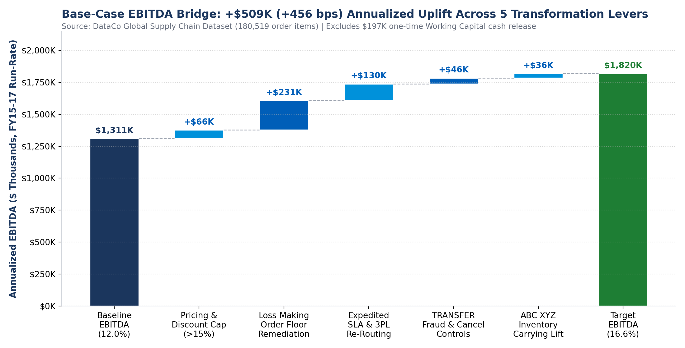
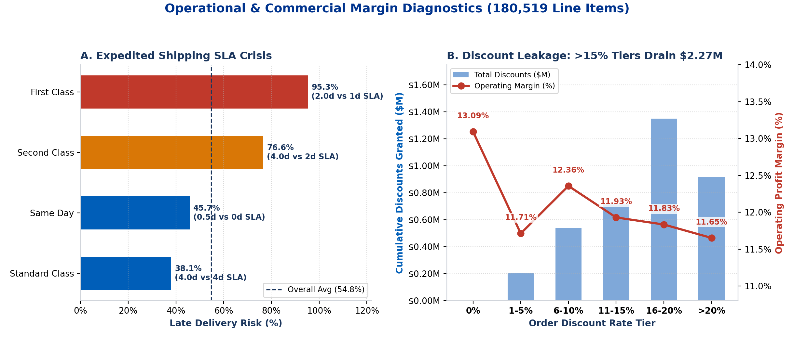
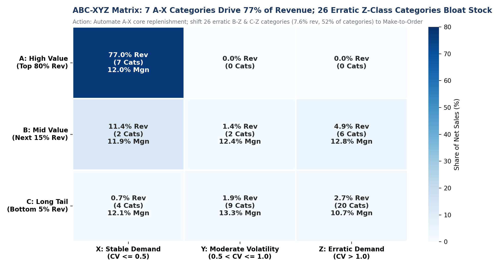
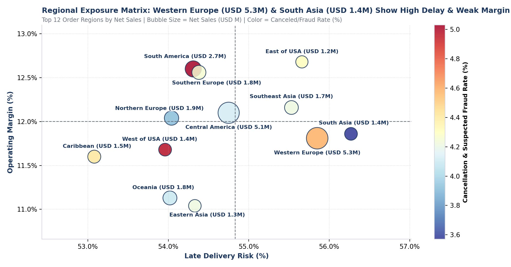

# Supply Chain & Working Capital EBITDA Transformation Model

> **Strategy & Operations Case Study:** End-to-end operational diagnostic, SQL/Python analytics pipeline, and dynamic 3-scenario Excel financial model linking supply chain bottlenecks, pricing governance, and inventory optimization directly to **EBITDA margin expansion** and **working capital release**.

---

## Executive Summary

Analyzing **180,519 order line items** (**65,752 unique orders**, **50 product categories**, **5 global markets**, **$33.05M cumulative Net Sales**) from the DataCo Global Supply Chain dataset exposed five structural profit and cash-flow leaks dragging baseline operating margin to **12.01%** (**$1.31M annualized EBITDA** on **$10.92M annualized Net Sales**, FY2015–FY2017 average):

| Metric | Baseline (FY15–17 Avg) | Conservative | **Base Case** | Target Case |
| :--- | :---: | :---: | :---: | :---: |
| **Annualized Net Sales** | $10,918,817 | $10,954,978 | **$10,985,113** | $11,015,248 |
| **Annualized EBITDA** | $1,311,020 | $1,607,528 | **$1,820,106** | $2,023,412 |
| **EBITDA Uplift ($ / %)** | — | +$296,508 (+22.6%) | **+$509,086 (+38.8%)** | +$712,391 (+54.3%) |
| **EBITDA Margin (%)** | 12.01% | 14.67% | **16.57%** | 18.37% |
| **Margin Expansion (bps)** | — | +267 bps | **+456 bps** | +636 bps |
| **Working Capital Released** | — | $118,452 (6d DIO) | **$197,420 (10d DIO)** | $296,131 (15d DIO) |



---

## Key Operational & Financial Findings

### 1. Expedited Shipping SLA Crisis (`95.3%` First Class & `76.6%` Second Class Late Rates)
- Across all orders, **54.8% (98,977 line items; $18.08M Net Sales)** miss scheduled delivery windows.
- **Root Cause:** `First Class` promises **1.0 day** but averages **2.00 days** (**95.3% late rate**); `Second Class` promises **2.0 days** but averages **3.99 days** (**76.6% late rate**). By contrast, `Standard Class` meets its 4-day promise on average (3.996 days; 38.1% late rate).
- **Action:** Re-engineer carrier routing for expedited tiers, shift regional 3PL cutoffs, and recalibrate customer-facing SLA bands to eliminate expedite rework, credits, and churn.

### 2. Commercial Discounting & Negative-Profit Tail Leakage (`-$3.88M` Cumulative Losses)
- **18.7% of all transactions (33,784 items)** are loss-making, leaking **-$3.88M** cumulatively (**-$1.28M/yr** annualized).
- **$2.27M (60.8% of total discounts)** is granted in `>15%` discount tiers, where operating margin falls from **13.09%** (`0%` discount) to **11.65%** (`>20%` discount).
- **Action:** Implement an automated ERP discount guardrail capping discretionary discounts at **15%** and enforce a minimum unit margin floor on the negative-profit tail.



### 3. ABC-XYZ Inventory Rationalization (`7` Categories = `77%` of Revenue; `26` Erratic Categories = `52%` of Complexity)
- Just **7 A-X categories** (`Fishing`, `Cleats`, `Camping & Hiking`, `Cardio Equipment`, `Women's Apparel`, `Water Sports`, `Men's Footwear`) generate **77.0% of Net Sales ($25.46M)** with highly stable monthly demand (**CV ~0.30–0.31**).
- Conversely, **26 erratic B-Z and C-Z categories** represent **52% of the category portfolio** yet contribute only **7.6% of revenue**, with **C-Z categories** posting the lowest operating margin (**10.66%**).
- **Action:** Deploy automated JIT replenishment for `A-X` core items while transitioning `B-Z/C-Z` long-tail categories to Make-to-Order / vendor drop-ship—cutting DIO by **10 days** (Base Case), releasing **$197.4K in working capital cash**, and delivering **$35.5K/yr** in carrying-cost EBITDA lift.



### 4. Payment Channel Risk Audit (`100%` of Suspected Fraud & Cancellations Originate in `TRANSFER`)
- SQL diagnostics revealed a stark single-channel risk concentration: **100.0% of all `SUSPECTED_FRAUD` (4,062 items) and `CANCELED` orders (3,692 items)** occur exclusively within the `TRANSFER` payment method—a **15.54% failure rate** destroying **$1.41M in Net Sales** (`CASH`, `DEBIT`, and `PAYMENT` have **0.00%** fraud/cancellation).
- **Action:** Deploy an automated pre-shipment payment verification & fraud-scoring gate specifically on `TRANSFER` orders to eliminate preventable reverse-logistics overhead and margin leakage without adding friction to other payment channels.

### 5. Regional Exposure Prioritization
- **Western Europe ($5.30M Net Sales; 55.8% late rate; 11.81% margin)** and **South Asia ($1.40M Net Sales; 56.3% late rate; 11.86% margin)** combine high delivery delay with below-average profitability, making them Tier-1 pilot regions for 3PL SLA transformation.



---

## Deliverables & Repository Architecture

| File / Folder | Description |
| :--- | :--- |
| **`deliverables/EBITDA_Transformation_Model.xlsx`** | **4-tab dynamic Excel financial model** (285 live formulas, 0 hardcoded outputs, 2 native charts): `Executive_Summary`, `Operational_Diagnostics`, `EBITDA_Bridge_Model`, and `Sensitivity_Analysis`. Lightweight (~24 KB) for instant viewing in Excel Online or Google Sheets. |
| **`src/01_data_cleaning_and_diagnostics.py`** | End-to-end Python & SQLite (`sqlite3`) ETL pipeline executing SLA diagnostics, payment risk auditing, ABC-XYZ segmentation, discount leakage analysis, and generating all 4 charts. |
| **`src/02_build_ebitda_model.py`** | Automated `openpyxl` financial model builder generating the formatted, formula-driven Excel workbook directly from diagnostic outputs. |
| **`outputs/summary_tables/`** | Clean aggregated CSVs and `baseline_metrics.json` feeding the financial model. |
| **`outputs/charts/`** | Publication-grade PNG visuals embedded in this executive case study. |

---

## Prioritized Implementation Roadmap

| Horizon | Initiative | Target Bottleneck | Base Annualized EBITDA Lift | Execution Risk |
| :--- | :--- | :--- | :---: | :---: |
| **Quick Win (0–3 Mo)** | Automated `TRANSFER` Payment Verification Gate | 100% of fraud & cancels isolated to `TRANSFER` ($1.41M failed sales) | **+$46,020** | Low |
| **Quick Win (0–3 Mo)** | ERP >15% Discretionary Discount Guardrail | $2.27M (60.8%) of discounts in >15% tiers | **+$66,296** | Low |
| **Medium-Term (3–6 Mo)** | Minimum Margin Floor on Loss-Making Tail | 18.7% orders negative profit (-$3.88M cumulative) | **+$230,857** | Medium |
| **Medium-Term (3–6 Mo)** | First & Second Class Carrier / SLA Re-Engineering | 95.3% First Class & 76.6% Second Class late delivery | **+$130,376** | Medium |
| **Structural (6–12 Mo)** | ABC-XYZ SKU Rationalization & MTO Shift | 26 B-Z/C-Z categories = 52% portfolio, 7.6% revenue | **+$35,536** *(+$197.4K Cash)* | Medium-High |

---

## Tech Stack & Methodology
- **Data Engineering & Quantitative Diagnostics:** Python (`Pandas`, `NumPy`), SQL (`SQLite`)
- **Financial Modeling & Digital Enablement:** Automated Excel Model Generation (`openpyxl`), 3-Scenario EBITDA Bridge, 2-Way Sensitivity Matrices
- **Executive Storytelling & Visualization:** `Matplotlib`, `Seaborn`

```bash
# Reproduce full pipeline locally (place DataCoSupplyChainDataset.csv in data/)
pip install -r requirements.txt
python src/01_data_cleaning_and_diagnostics.py
python src/02_build_ebitda_model.py
```
